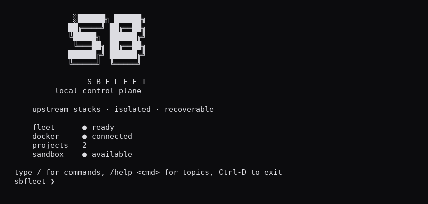
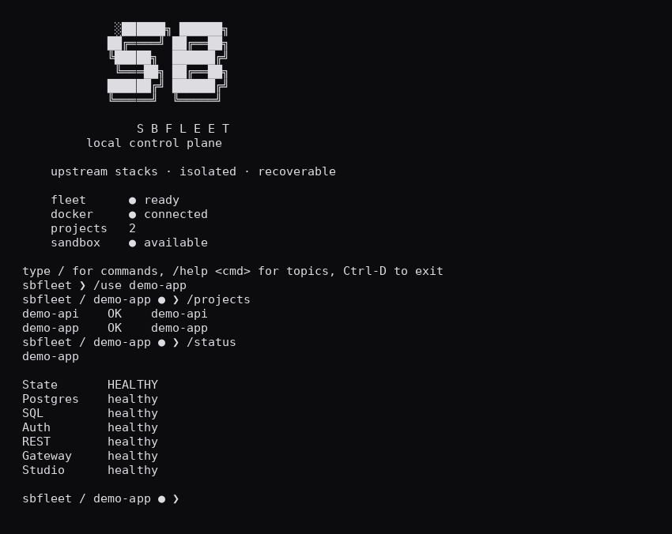
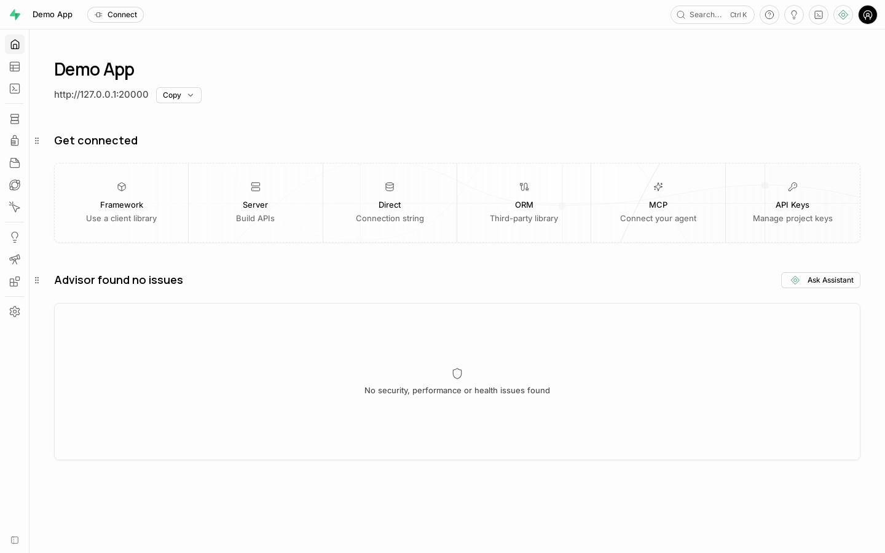
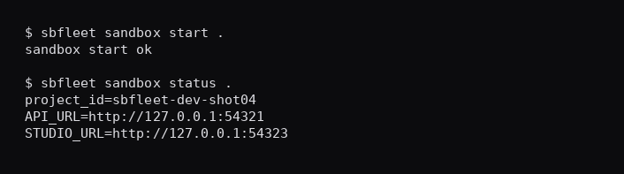

# SBfleet

**Local control plane for self-hosted Supabase stacks.**

Run multiple independent self-hosted Supabase projects on one Linux host, with isolated ports and resources, upstream Studio, guarded lifecycle management, encrypted recovery, and disposable local development sandboxes.

[](https://www.python.org/downloads/)
[](LICENSE)

## Why SBfleet

Keep separate backends for your applications without maintaining a collection of ad-hoc Compose commands and port assignments. SBfleet manages an official self-hosted Supabase stack per project and keeps each project's identity, secrets, data, and lifecycle explicit.

### Key capabilities

- **Independent projects:** separate Compose resources, secrets, and collision-checked host port allocations.
- **Upstream Studio:** a separate Supabase Studio for each managed project.
- **CLI operations:** create, start, stop, inspect, connect, and diagnose projects; an interactive shell is included.
- **Encrypted recovery:** cold backups with disposable recovery verification and same-pin restore.
- **Explicit updates:** reviewed upstream transitions with guarded continuation after interruption.
- **Local sandboxes:** disposable official Supabase CLI stacks for application and coding-agent workflows.

## Quick start

Start on a Linux host with the [requirements](#requirements) below. Clone the public source and run the user installer:

```bash
git clone https://github.com/Pepinko81/sbfleet.git
cd sbfleet
export PATH="$HOME/.local/bin:$PATH"
bash scripts/install-user.sh

sbfleet --version
sbfleet doctor
sbfleet create myapp --yes
sbfleet start myapp
sbfleet status myapp
sbfleet connection myapp
sbfleet studio myapp --url-only
```

Resolve any readiness failures before creating a project. This source tree installs **1.1.0**. Release publication is tracked on the [GitHub releases page](https://github.com/Pepinko81/sbfleet/releases).

Before your first backup, configure an age recipient in `fleet.json` and keep the corresponding private identity securely backed up outside the fleet data directory. See [backup setup](docs/OPERATIONS.md#backup-and-restore). With your identity file in place:

```bash
sbfleet backup myapp --identity /secure/backup.agekey
```

Backup verification is enabled by default and requires downtime. Replace the example identity path with your own.

## Example workflow

```bash
sbfleet projects
sbfleet logs myapp auth --tail 100
sbfleet doctor myapp
sbfleet stop myapp
sbfleet start myapp
```

Run `sbfleet` in a terminal for the interactive shell. Use `/use myapp` to select a project for that session, `/status` to inspect it, and `/use --clear` to return to the fleet root. Direct CLI commands use explicit project slugs.

For host applications, get allocated endpoints from `sbfleet connection myapp`; never assume host PostgreSQL is on port `5432`. Use an application-owned least-privilege role for runtime access. The explicit admin environment helper is available for operator-run migrations; see the [CLI reference](docs/CLI_REFERENCE.md).

## Multiple isolated projects

```bash
sbfleet create orders --yes
sbfleet create inventory --yes
sbfleet start orders
sbfleet start inventory
sbfleet projects
sbfleet connection orders
sbfleet connection inventory
```

Each project has its own Compose identity, data, secrets, and reserved host ports. Published ports bind to loopback by default. Capacity depends on host resources; there is no fixed project-count limit. This is operational isolation for a trusted local operator, not hostile multi-tenant isolation.

See [network and ports](docs/NETWORK_AND_PORTS.md) and [project lifecycle](docs/PROJECT_LIFECYCLE.md).

## Studio

SBfleet launches **upstream Supabase Studio** through each project's gateway. It does not replace or rebrand Studio.

```bash
sbfleet studio myapp
sbfleet secrets myapp --reveal --keys DASHBOARD_USERNAME,DASHBOARD_PASSWORD
```

The second command deliberately reveals the project's HTTP Basic Auth credentials. Over SSH, arrange your own port forwarding to reach the server's loopback URL.

Use `sbfleet configure myapp --name "My App" --studio-project "My App"` to change display names without changing the project slug. Apply Studio environment changes with a guarded stop followed by start; plain restart does not refresh container environment. See [Studio and nginx](docs/STUDIO_AND_NGINX.md).

## Backup and recovery

The bounded important-data recovery contract covers the supported standard profile with file-backed Storage: clean-shutdown PostgreSQL cluster data, database configuration and cryptographic keys, Storage bytes, and deployment configuration including functions and snippets. Recovery verification checks the restored data against snapshot-bound source facts; an archive's existence alone is not recovery proof.

```bash
sbfleet backup myapp --identity /secure/backup.agekey
sbfleet restore myapp /path/to/archive.tar.age --yes --identity /secure/backup.agekey
```

Restore targets the **same project, exact upstream pin, and compatible architecture/image set**. The requested archive is recovery-verified before target mutation. Keep off-host copies and recovery identities, and validate your own recovery procedure before entrusting important data.

Cold backups require downtime. PITR, arbitrary S3 recovery, external tablespaces, absent-project recovery, and generic cross-version rollback are unsupported. Cleanup failures report residuals and return nonzero while retaining a successfully created encrypted archive.

Read the [backup and restore contract](docs/BACKUP_RESTORE.md). Updates follow reviewed directed edges only; interrupted updates use the original operation's `--reconcile` flow, with evidence checks. See [update strategy](docs/UPDATE_STRATEGY.md).

## Development sandbox and coding agents

A sandbox is a disposable, local-only official Supabase CLI stack associated with an application repository. It is separate from long-lived fleet projects and requires no Cloud login or link.

Initialize a fresh application repository using the installer-managed CLI:

```bash
cd ~/my-app
"$HOME/.local/lib/sbfleet/current/tools/supabase/2.118.0/supabase" init
# Edit supabase/config.toml: set project_id to a unique "sbfleet-dev-..." value.

sbfleet sandbox start .
sbfleet sandbox status .
sbfleet sandbox studio .
sbfleet sandbox reset . --yes
sbfleet sandbox destroy . --yes
```

Use an existing initialized config without overwriting it. Reset is destructive to local sandbox data; destroy removes owned sandbox resources and preserves application source. Configure distinct app-local ports if running several sandboxes.

Give coding agents access only to disposable development data. The wrapper checks local endpoints, configuration, credentials, and resource ownership, but same-user filesystem or Docker access can bypass it. A dedicated development OS user or VM with its own Docker daemon provides a stronger boundary. See [sandbox workflows](docs/DEV_SANDBOX.md) for SQL and external migration modes and guarded child-command environments.

## Architecture and design

SBfleet is a Python CLI with one process per invocation, a filesystem registry, and per-project locks. It has **no daemon, control-plane database, or custom Studio**. Fleet data defaults to `~/.local/share/sbfleet`, independently of the installed software.

Projects use pinned official self-hosted Supabase stacks. Routine lifecycle uses upstream `run.sh`; reviewed updates stage upstream `update.sh` before promotion. The current default pin is `self-hosted/v0.8.2`. See [architecture](docs/ARCHITECTURE.md) and [upstream reference](docs/UPSTREAM_SUPABASE_REFERENCE.md).

## Safety model

- Mutations require identity, ownership, configuration, and lock checks; unknown authority fails closed.
- Ordinary diagnostic output redacts configured secrets; explicit reveal and child-command output require operator care.
- Default removal requires a usable recovery-verified archive; bypassing backup is an explicit operator choice.
- Updates require a recovery-verified backup and a reviewed transition; no implicit latest or automatic downgrade.
- Cleanup targets proven-owned resources. SBfleet performs no global Docker prune or broad name-based deletion.

The threat model trusts the local operator. See [secrets and security](docs/SECRETS_AND_SECURITY.md) and [security reporting](SECURITY.md).

## Supported boundaries

- One Linux host with local Docker Engine; no multi-host orchestration, Kubernetes, or managed cloud service.
- Host applications connect through allocated loopback ports. Applications in other Docker containers and universal remote database exposure are not supported.
- nginx templates are optional; DNS, certificates, TLS deployment, and privileged installation remain operator responsibilities.
- Signup email/SMS delivery needs real provider configuration. See [self-hosted OAuth](docs/SELF_HOSTED_OAUTH.md) for authentication setup.
- macOS, Windows, remote Docker, and Podman are not first-class supported hosts.

## Screenshots

**Interactive shell**



**Project status**



**Upstream Supabase Studio launched per managed project**



**Disposable sandbox lifecycle**



## Documentation

- [CLI reference](docs/CLI_REFERENCE.md) and [command contracts](docs/COMMAND_SPEC.md)
- [Operations](docs/OPERATIONS.md), [backup and restore](docs/BACKUP_RESTORE.md), [updates](docs/UPDATE_STRATEGY.md)
- [Development sandboxes](docs/DEV_SANDBOX.md), [Studio and nginx](docs/STUDIO_AND_NGINX.md)
- [Architecture](docs/ARCHITECTURE.md), [security model](docs/SECRETS_AND_SECURITY.md), [quality boundaries](docs/QUALITY_AND_SECURITY.md)
- [Contributing](CONTRIBUTING.md), [testing](docs/TESTING_STRATEGY.md), [changelog](CHANGELOG.md)

## Requirements

- Linux **amd64 or arm64**, local Docker Engine **28+**, Compose v2 with `!override` support, and a Docker-authorized user.
- Python **3.10+** with `venv`, Git, sh/coreutils, jq, OpenSSL, and Node **16+**.
- Enough memory and disk for each full Supabase stack, backup staging, and recovery verification.

The user installer provisions pinned Supabase CLI **2.118.0** and age **1.3.2** with committed SHA256 checks. See [tool pins](packaging/tool-pins.toml) and [third-party notices](THIRD_PARTY_NOTICES.md).

## Installation and uninstall

From the source checkout, `bash scripts/install-user.sh` installs a non-editable package under `~/.local/lib/sbfleet/current/` and exposes `~/.local/bin/sbfleet`. Managed helper tools remain private to that installation. No sudo is needed once Docker access exists.

Re-run the installer from the desired source version to upgrade. It stages and verifies a generation before promotion. `--configure-path` optionally adds `~/.local/bin` to `~/.profile`; an existing shell may still need the PATH export shown above. Installer output distinguishes installed artifacts from current-shell readiness; incomplete readiness exits with code 4.

```bash
bash scripts/uninstall-user.sh
```

Uninstall removes managed software and the SBfleet shim. It preserves fleet data, Docker resources, and unrelated binaries. Contributor setup is documented in [CONTRIBUTING.md](CONTRIBUTING.md).

## Project status

SBfleet **1.1.0** is a feature release adding fleet observability, local read-only
agent integration, verified same-pin cloning, and read-only schema planning.
See the [1.1.0 release notes](CHANGELOG.md#110--release-candidate).
This release candidate is prepared for publication; the current public release
remains v1.0.1 until v1.1.0 is published. Migration planning does not execute SQL,
and there is no `migrate apply`.

## Independence

SBfleet is an independent open-source project and is **not affiliated with, sponsored by, or endorsed by Supabase**. Third-party names and marks belong to their respective owners.

## License

[MIT](LICENSE). Upstream software retains its own licenses; see [third-party notices](THIRD_PARTY_NOTICES.md).

## v1.1.0 capabilities

These capabilities are included in this 1.1.0 release candidate, in addition to
the existing isolated stacks, guarded lifecycle, upstream Studio, verified
recovery and disposable local sandbox.

### Fleet observations and coding agents

`sbfleet status --all --json` returns the versioned, secret-safe fleet snapshot.
`sbfleet dashboard` opens a **read-only** terminal dashboard (arrows to select,
`r`/`R` to refresh, Enter for details, `?` for help, `q`/`Q` or Ctrl+C to quit).
Use `--refresh 30` for periodic observations or
`--once` for plain output. No lifecycle actions are available.
The interactive shell exposes the same dashboard as `/dashboard`, listed in
`/help` and Tab completion; quitting returns to the shell.

`sbfleet mcp` serves the same observations through **local-only, read-only stdio
MCP**. It has no TCP listener and no credential or mutation tools. See
[CLI reference](docs/CLI_REFERENCE.md#fleet-observation-interfaces) for the schema,
limitations and agent configuration.

### Verified project clone

`sbfleet clone SOURCE TARGET --identity /private/age-identity.txt [--json]`
creates a verified clone with a fresh project UUID, Compose identity, ports and
paths. The initial supported pin is exactly `self-hosted/v0.8.2` at
`564eab8ad7840b13324f68b1bfac074ef8d51c21`; cross-pin cloning is refused.
Pooler tenant state is rebound to the destination, and the target ends **STOPPED**.
The source returns to its prior runtime state. Required application recovery
credentials remain shared; cloning does not rotate them. Ordinary same-project
restore semantics are unchanged. See [clone contract](docs/BACKUP_RESTORE.md#verified-same-pin-clone).

### Read-only schema diff and migration planning

`sbfleet schema diff SOURCE TARGET [--json]` compares PostgreSQL catalogs.
SOURCE is the desired schema; differences describe changes to make TARGET match it.
`sbfleet migrate plan SOURCE TARGET [--json]` classifies those same differences as
SAFE, REVIEW_REQUIRED, DESTRUCTIVE or UNSUPPORTED. Both require running, owned
project databases on the reviewed same pin. Neither command changes a database,
starts a project, executes migration SQL or upgrades Supabase. No `migrate apply`
exists. SQL preview is intentionally deferred.

The local MCP tools `schema_diff` and `migration_plan` use the same services.
Dashboard refresh does not perform schema comparisons. See the
[schema contract](docs/CLI_REFERENCE.md#schema-diff-and-migration-plan) for coverage,
expression fingerprints, unsupported semantics and conservative plan rules.

## Roadmap

Roadmap reflects current direction and may change; it is not a delivery commitment.

### Included in v1.1.0

- Multiple isolated self-hosted Supabase stacks
- Upstream Studio per project
- Guarded lifecycle
- Encrypted backup / verified recovery
- Disposable local sandbox
- Read-only fleet dashboard
- Machine-readable fleet JSON
- Local read-only MCP
- Verified same-pin project cloning
- Schema diff
- Migration planning (read-only; no migration execution)

### Next

- Scheduled backups
- Retention policies
- Fleet-wide operations
- Health / backup notifications

### Later

- Rich local control-plane UI
- Guarded migration execution
- Project/environment templates
- Staging workflows
